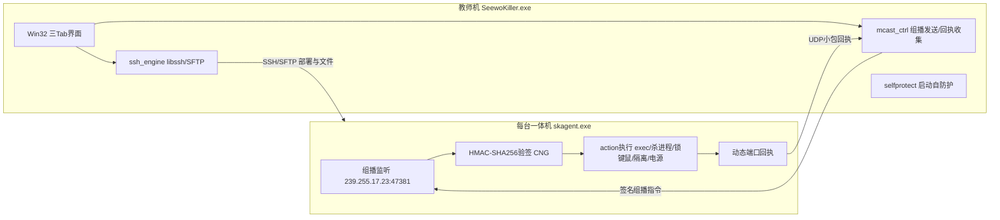

# SeewoKiller

教室希沃一体机批量管理工具：控制台 + 常驻 agent，组播下发签名指令，SFTP 分发文件，
突破 SSH 会话隔离在真实桌面执行操作。

> 本仓库同时是一个**软件工程教学示范项目**：从源码到安装包一条命令复现，
> 每个环节（构建/测试/版本/发布/CI）都有对应的文件和文档，见文末「教学指南」。

## 架构



- **控制台**（`SeewoKiller.exe`）：批量 SSH/SFTP、Agent 部署、组播指令、回执墙。
  以管理员运行时自动执行自防护（防火墙/封22/445/停sshd/占关机位）。
- **Agent**（`skagent.exe`）：静态链接纯 C 单文件，部署到 `C:\Temp\SK\`，
  计划任务 `SeewoAgent`（ONLOGON + 最高权限 + 交互会话）拉起。
  HMAC 验签失败的包静默丢弃；每条指令只对 `targets`（IP框范围）内的机器生效。

## 目录结构

```
├── VERSION               # 唯一版本来源，改版本只改这里（setup.iss 需同步）
├── build_release.bat     # 一键出包：构建→测试→安装包（含版本一致性校验）
├── CMakeLists.txt        # 双目标 + ctest；版本从 VERSION 注入 agent
├── setup.iss             # Inno Setup 安装包脚本
├── agent/skagent.c       # agent 本体（纯 C，组播监听/验签/全部 action）
├── src/                  # 控制台源码
│   ├── sk_protocol.c/h   # ★ 通信协议（纯C可单测）：包头/HMAC/迷你JSON/防重放
│   ├── mcast_ctrl.*      # 控制台组播收发
│   ├── selfprotect.*     # 启动自防护
│   ├── ssh_engine.*      # 批量 SSH/SFTP 引擎
│   └── main.cpp          # Win32 界面
├── tests/test_protocol.c # 协议层单元测试（ctest）
├── docs/PROTOCOL.md      # 通信协议规范
└── docs/CI.md            # Gitea Actions runner 搭建
```

## 环境搭建

| 组件 | 用途 | 备注 |
|---|---|---|
| Visual Studio 2022+（含MSVC/WinSDK） | 编译器 | 本项目在 VS18 实测 |
| CMake ≥ 3.21 | 构建系统 | |
| vcpkg + `libssh` `webview2` | 第三方库 | 见下方离线安装经验 |
| Inno Setup 6 | 打安装包 | `setup.iss` 一键脚本 |

### vcpkg 离线安装（踩坑实录）

vcpkg 下载源不走系统代理，受限网络下建议**预下载到缓存**再安装。全部文件
SHA512 均可在 portfile/`scripts/vcpkg-tools.json` 里核对：

1. 仓库本体：GitHub `microsoft/vcpkg` zip，解压后 `bootstrap-vcpkg.bat`
   （它还要从 GitHub 下 `vcpkg.exe`，同样可预下载放到仓库根目录）
2. `downloads\` 里预放源码包：openssl（注意 vcpkg 缓存文件名是
   `openssl-openssl-openssl-<ver>.tar.gz`）、libssh、webview2（NuGet zip）
3. openssl 构建**额外**需要三个工具（会在首次构建时自动下载，同样可预放
   `downloads\`）：Strawberry Perl、NASM、jom —— 版本以 `scripts/cmake/
   vcpkg_find_acquire_program(PERL/NASM/JOM).cmake` 里锁定的为准
4. `vcpkg install libssh:x64-windows webview2:x64-windows`

新 vcpkg 的 libssh 默认不带 zlib，工程不再依赖 `zlib1.dll`。

## 构建

```
build_release.bat
```

脚本依次做：版本一致性校验（VERSION vs setup.iss）→ CMake 配置构建 →
ctest 单元测试 → Inno 打包。任何一步失败即停，产物在 `installer\`。

只想跑测试：`cmake -B build -DVCPKG_ROOT=... && cmake --build build --config Release
&& ctest --test-dir build -C Release`

## 版本与发布

1. 改根目录 `VERSION`（如 `4.3.0`）
2. 同步 `setup.iss` 里的 `MyAppVersion`（不改会被出包脚本拦下）
3. `build_release.bat` → 产物在 `installer\`
4. 打 tag：`git tag v4.3.0 && git push --tags`

agent 版本随构建自动注入（来自 VERSION），`ping` 回执里可见
（`alive v<版本>`），用于识别机房里各机器 agent 的代次。

## 运维模型（还原卡环境）

一体机通常有还原卡：部署（一键部署按钮）后本节课内可用，重启即回到基线。
因此**没有做** agent 自升级/卸载/日志落盘——每次上课需要时重新一键部署即可
（十几秒）。这是刻意的取舍，不是缺失。

## 教学指南（每节课看哪里）

| 工程概念 | 看这里 | 讲什么 |
|---|---|---|
| 构建系统 | `CMakeLists.txt` | 多目标、编译定义注入、POST_BUILD 拷贝、ctest 挂接 |
| 通信协议设计 | `docs/PROTOCOL.md` + `src/sk_protocol.c` | 二进制头/签名域/防重放/动态端口 |
| 单元测试 | `tests/test_protocol.c` | 每条断言对应一个真实踩过的 bug（见文件头注释） |
| 版本管理 | `VERSION` + `build_release.bat` | 单一事实来源、出包前一致性校验 |
| 持续集成 | `.gitea/workflows/build.yml` + `docs/CI.md` | 推送即构建，坏提交当场暴露 |
| 编码问题 | `agent/skagent.c` 编码辅助函数 | UTF-8(协议) vs ACP(执行层)，中文双转 bug 复盘 |
| 权限模型 | 计划任务 `/RL HIGHEST /IT` vs SYSTEM | 为什么 agent 必须在交互会话而不是 session 0 |

## FAQ（真实踩坑）

- **C1083 找不到 libssh/libssh.h**：`VCPKG_ROOT` 没指对。用
  `-DVCPKG_ROOT=` 指定，或改 CMakeLists 里的默认值。
- **链接期/POST_BUILD 报 zlib1.dll**：老仓库遗留，新 vcpkg 无此依赖。
- **组播发了没回执**：先 `tasklist` 确认 agent 在跑；查交换机 IGMP snooping；
  防火墙放行规则是否随部署写入。
- **回执 `ts out of window`**：板子时钟偏差超过 15 分钟（防重放窗口拒绝）。
- **msg 中文弹窗不显示**：v4.1 前的存量 bug（协议 UTF-8 与执行层 ACP 双转），
  已修复——见 `utf8_to_acp`/`do_msg` 注释。
